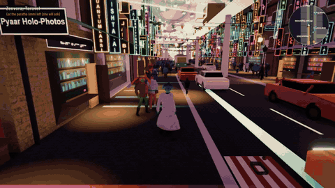
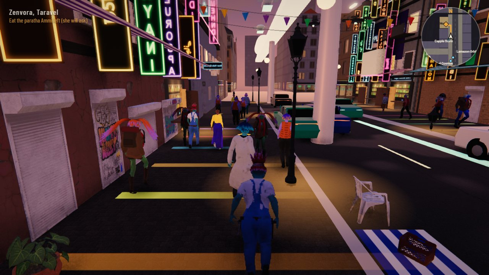
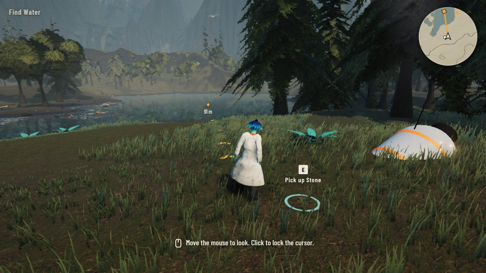
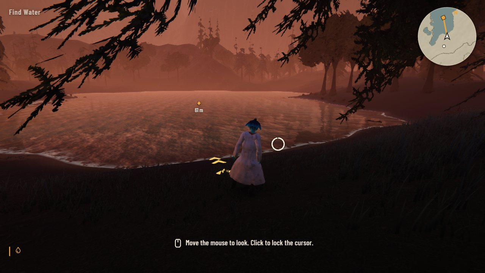
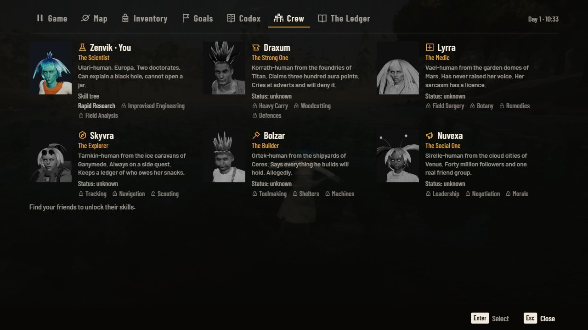
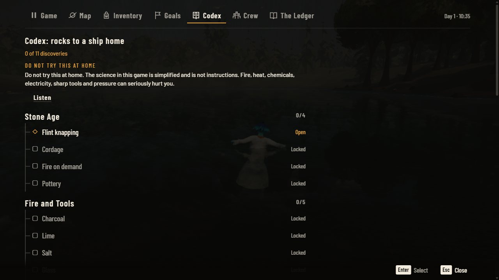
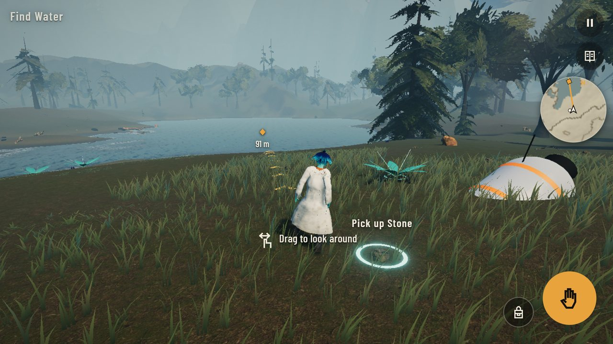

<p align="center">
  <a href="https://megazron.github.io/beyond-sagittarius/">
    <picture>
      <source media="(prefers-color-scheme: dark)" srcset="public/brand/logo.svg">
      <source media="(prefers-color-scheme: light)" srcset="public/brand/logo-ink.svg">
      
    </picture>
  </a>
</p>

<p align="center">
  A sci-fi survival story. Stranded past a black hole, rebuild science from one rock.
</p>

<p align="center">
  <a href="https://megazron.github.io/beyond-sagittarius/"></a>
</p>

<p align="center">
  
</p>

Year 2189. A suspiciously cheap tourist route to the galactic centre ends at Sagittarius A*.
You wake up alone on a planet nobody charted, with a dying wrist device and something very
large walking between the trees. The jokes come first. The fear catches up.

Then you rebuild science from nothing, one rock at a time, because the way home is a ship and
the ship is several thousand years of homework away.

I make this game on my own. It is free, has no ads and no in-app purchases, and collects no data.

## What is in it

- **The opening in Zenvora**, a spaceport city you can walk before take-off: districts, traffic, a tram,
  crowds, shops, a map and GPS, time of day and rain.
- **Chapter One: The First 24 Hours** (levels 1 to 10): water, food, fire, a shelter, a spear, the first night.
- **Chapter Two: Rocks to Reason** (levels 11 to 21): knapping, cordage, pottery, charcoal, lime, glass, soap,
  fermentation.
- **Real science in the right order.** One discovery per level, each with a short, true explanation in the codex.
- **Choices that stick.** Timed decisions and quick-time moments. The Ledger keeps all of it, and MegaZroN, the
  narrator, reads it back to you, rudely.
- **Six friends, six faces.** Each with their own lineage, voice and bad habits. Build your own Scientist in the
  character creator.

| | |
| --- | --- |
|  |  |
|  |  |
|  |  |

## Play

| Platform | How | Notes |
| --- | --- | --- |
| Browser | [megazron.github.io/beyond-sagittarius](https://megazron.github.io/beyond-sagittarius/) | No install, no account. A current browser with WebGL2. |
| Android | Coming to Google Play | The same game, fully offline, with no permissions. |
| Windows | [Releases](https://github.com/megazron/beyond-sagittarius/releases/latest) | Windows 10 or 11, x64. The build there is older (0.2.0). It is unsigned, so SmartScreen warns you: choose **More info**, then **Run anyway**. |

Pick a quality preset in Settings: **Mobile** for phones, **Web** for integrated graphics, **Ultra** for a
laptop GPU or better. On phones, a recent one with plenty of memory is recommended.

## Languages

English, Hindi and Urdu text, Urdu right to left. Most lines are voiced in all three; the rest are spoken in
English under Hindi or Urdu subtitles for now. Voice and subtitle languages are set separately. The voices are
synthetic, and Hindi and Urdu have not had a native speaker's review yet.

## Controls

| Action | Keyboard and mouse | Touch | Gamepad |
| --- | --- | --- | --- |
| Move | W A S D (up and down arrows too) | Thumbstick on the left | Left stick |
| Look | Mouse (click to lock the cursor) | Drag | Right stick |
| Sprint | Shift | Button | Left trigger |
| Jump | Space | Button | A |
| Interact | E or F | Button | X |
| Inventory | I or Tab | Menu | Y |
| Crew | C | Menu | Right bumper |
| Codex | K | Menu | Left bumper |
| Map | M | Menu | View |
| Objectives | J or O | Menu | Right stick press |
| Pause | Esc | Button | Menu |
| Skip a cutscene | Enter or Esc | Tap | |

Everything can be remapped in Settings. On Android the back button opens the pause menu.

## Build from source

```bash
git clone https://github.com/megazron/beyond-sagittarius.git
cd beyond-sagittarius
npm install
npm run dev        # http://localhost:5173
npm run build      # production build into dist/
```

I use Node 22. The Android app (Capacitor) and the Windows app (Electron) are built from the same `dist/`:
see [DEVELOPMENT.md](DEVELOPMENT.md). What changed in each version is in [CHANGELOG.md](CHANGELOG.md).

## Safety

**Do not try this at home.** The science here is simplified for a game and is not instructions.
Fire, heat, chemicals, electricity, sharp tools and pressure can seriously hurt you.

The cutscenes use bright flashes and fast cuts, and the game includes flickering light. If you
are sensitive to that, take care.

## Privacy

The game has no accounts, no ads, no analytics and no tracking. Your save and settings stay on your device.
The Android app asks for no permissions at all, not even internet. Full text: [PRIVACY.md](PRIVACY.md), also at
[megazron.github.io/beyond-sagittarius/privacy.html](https://megazron.github.io/beyond-sagittarius/privacy.html).

## Licence and credits

All rights reserved: you may play the game and read this repository; see [LICENSE](LICENSE) and [TERMS.md](TERMS.md).
Third-party libraries, textures, models, animation, music, sounds, fonts and voice models keep their own licences,
listed in [CREDITS.md](CREDITS.md). Any brands in the game are parodies.

Found a bug? [Open an issue](https://github.com/megazron/beyond-sagittarius/issues/new/choose).
Security problems go through [private reporting](SECURITY.md).
