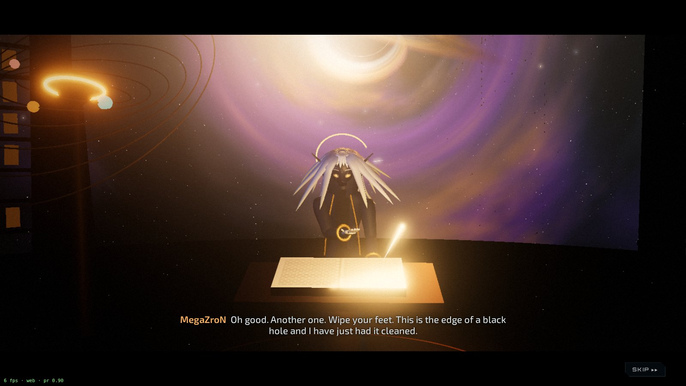
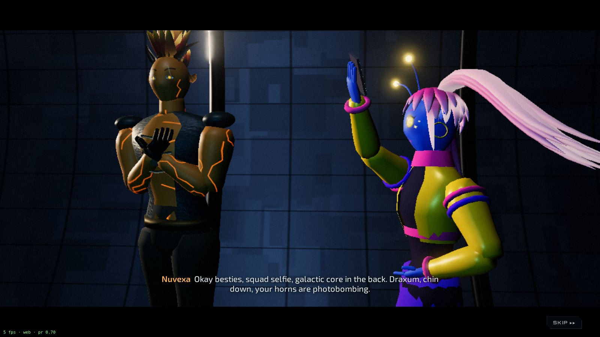
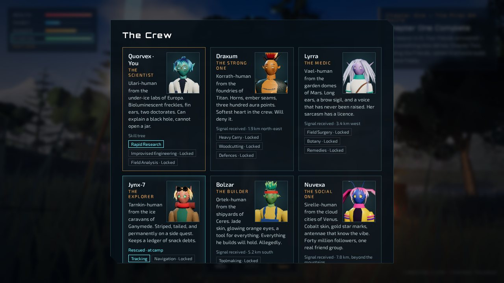
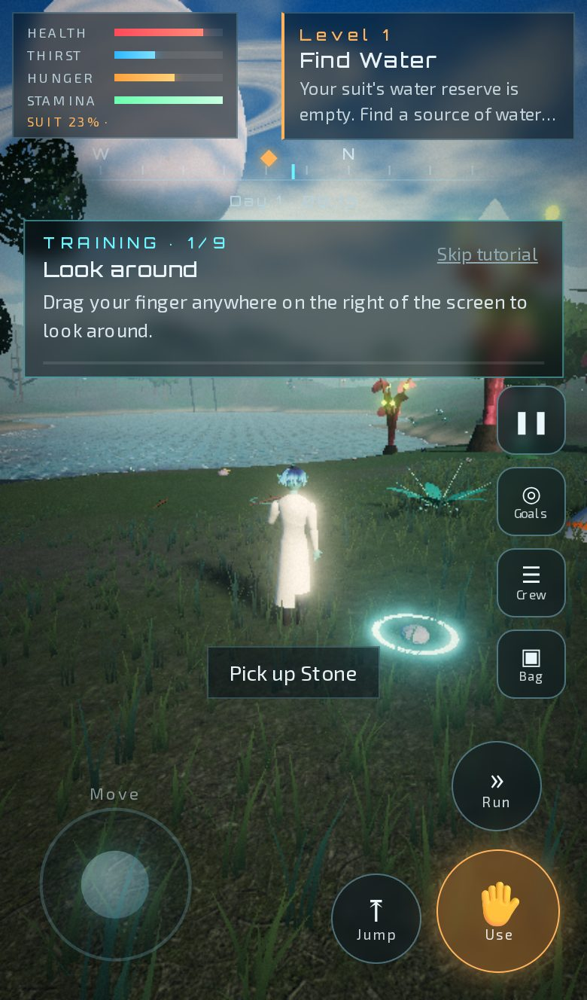
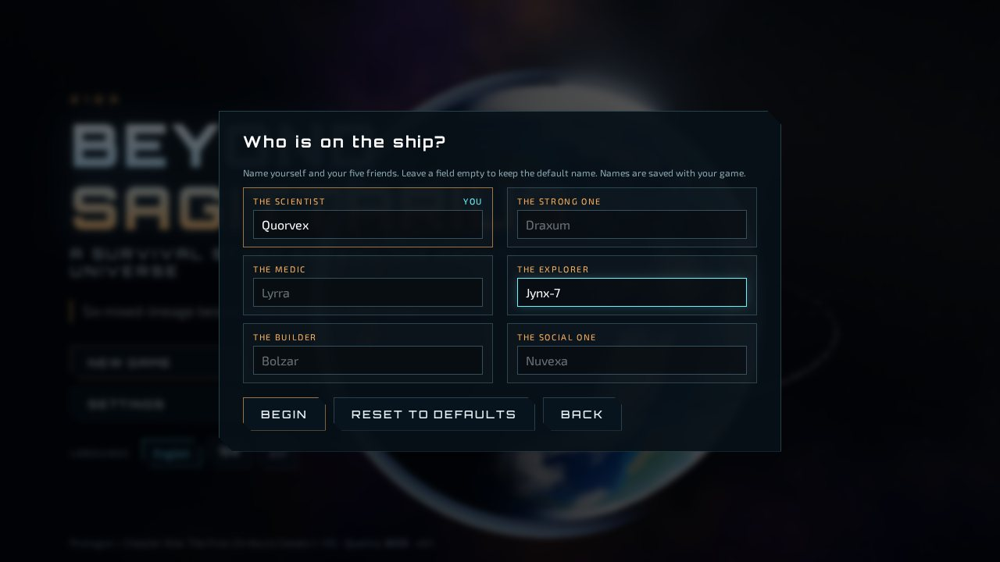
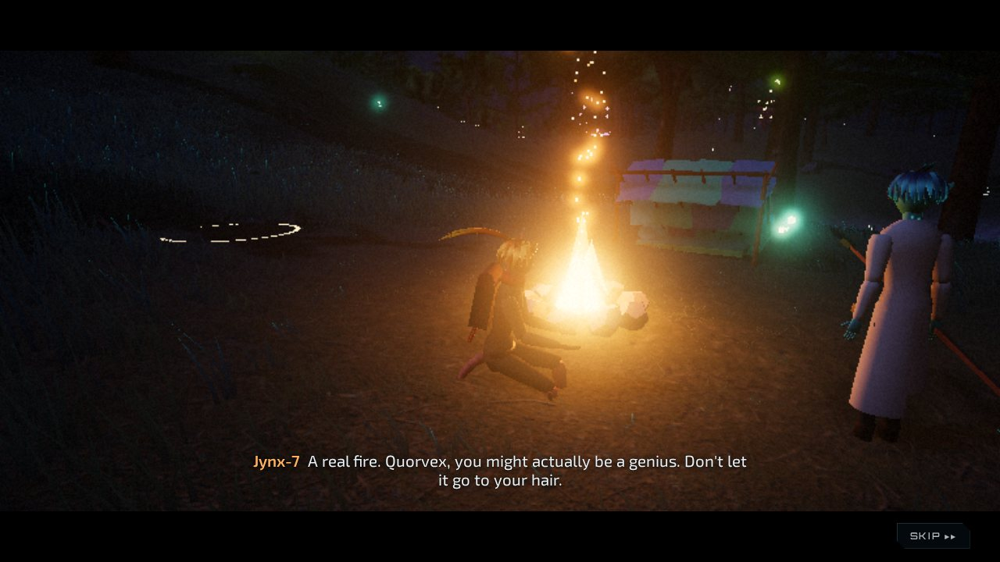
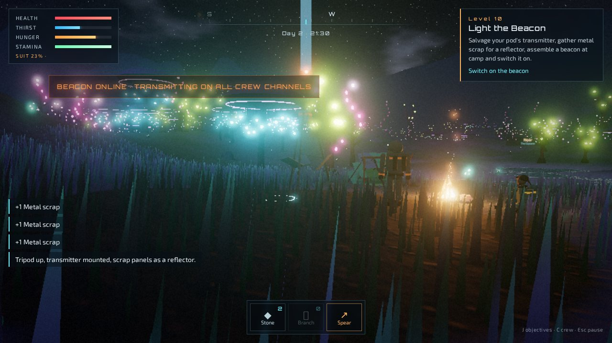

# BEYOND SAGITTARIUS
### A Survival Story Beyond the Known Universe

> *Humanity conquered the stars. Now you must learn how to survive without civilisation.*

An original 3D story-survival game that runs in the browser. This repository
holds the opening cinematic *"The Last Normal Day"*, the wake-up on an alien
world and the complete first arc, *Chapter One — "The First 24 Hours"*
(levels 1–10), ending on the arc's cliffhanger.











## The story so far

Year 2189. Nobody is just human any more: five alien lineages married into
ours, and six friends from six worlds book a tourist liner to the galactic
centre on a suspiciously free route. They roast each other, argue about snacks
and take far too many selfies. Then an impossible gravitational disturbance
near Sagittarius A* tears the ship apart. You, the Scientist, wake up alone
under two huge bodies in an unfamiliar sky, in a strange forest where something
enormous walks between the trees. The tone is horror-comedy: the jokes come
first, the fear catches up.

### The crew (default call-signs: rename everyone on the pre-game screen)

| | Role | Lineage and home | Look |
| --- | --- | --- | --- |
| **Zenvik** (you) | The Scientist | Ulari-human, under-ice labs of Europa | Teal skin, glowing freckles, fin ears, round glasses, scorched lab coat, sideswept blue fringe |
| Draxum | The Strong One | Korrath-human, foundries of Titan | Amber hide, ember seams, horns, vest, flame crest |
| Lyrra | The Medic | Vael-human, garden domes of Mars | Violet skin, long ears, brow sigil, field coat and satchel, silver curtain and plait |
| Skyvra | The Explorer | Tarnkin-human, ice caravans of Ganymede | Coral striped skin, tail, goggles, scarf, worn jacket, high amber tail |
| Bolzar | The Builder | Ortek-human, shipyards of Ceres | Jade skin, short and wide, rolled sleeves, overalls, tool belt, spiky tufts |
| Nuvexa | The Social One | Sirelle-human, cloud cities of Venus | Cobalt skin, gold stars, antennae, loud bomber, giant twin tails |

**MegaZroN** hosts the game from the Vault of the Last Ledger, an archive on
the rim of Sagittarius A*. He keeps the book in which every story ends, he
reads your choices back to you, and he is rude about them.

## What is in this slice

- **Phones**: touch controls (floating joystick, drag to look, pinch to zoom,
  buttons for use, jump, run, bag, crew, goals, pause), layouts for portrait
  and landscape with safe areas, and an automatic Mobile preset.
- **First-play tutorial** on level 1 that waits for you to actually do each
  thing, worded for keyboard or touch, skippable, remembered in the save and
  replayable from Settings.
- **MegaZroN's Vault**: narrator scenes at the start, after levels 3 and 7 and
  at the end of the chapter, which change with what you did (the thornberry,
  your deaths, the bites, renaming the crew).
- **Staged cutscenes** with cuts, coverage, poses and expressions: the deck
  roast before the disaster, the day-39 fight flashback, the rescue, the talk
  by the fire, the beacon and the accusation. All skippable.
- **Full dubbing** in English, Hindi and Urdu with separate voice, music and
  effects volumes and a mute (see `tools/tts/`).
- **Opening cinematic** (≈60 s, skippable): Earth in 2189 with an atmosphere
  shader, city lights, clouds and an orbital ring with stations; the tourist
  liner's departure with the mission display; a journey montage past a red
  planet and a ringed gas giant through nebulae; the observation deck where the
  Scientist spots the impossible reading; the AI warnings; a ray-marched
  **Sagittarius A\*** black hole with gravitational lensing and an accretion
  disk; gravity failure, escape pods, stretched starlight, a glimpse of another
  universe, white-out.
- **Wake-up sequence**: the moon and the giant ringed planet in the sky, the
  dying wrist device ("CREW STATUS: UNKNOWN / EMERGENCY SIGNAL: NO CONNECTION"),
  the crashed escape pod, and the huge Walker moving between the trees.
- **The alien planet**: procedural 1.4 km × 1.4 km terrain (chunked, 3 LOD
  levels with skirts), three original instanced tree species with
  bioluminescence and wind, GPU grass that follows the player, glowing ground
  plants and rocks, an animated lake (Fresnel sky reflection, sun glint, depth
  colour, shoreline foam, night plankton), sky with clouds, stars and the
  galactic core at night, day–night cycle (1 in-game hour = 50 s), fog.
- **Survival**: health, thirst, hunger, stamina; drinking, examining and eating
  fruit (one species is safe, one is poisonous), picking up stones and
  branches; death and retry.
- **Chapter One, levels 1–10, fully playable** (see the table below), with a
  compass marker that always points at the nearest thing you still need.
- **Crew in the world**: the Explorer is found injured beside her escape pod,
  splinted, follows you (walk/idle animation, name tag) back to camp and sits
  by the fire. The crew panel tracks who is rescued and whose signal answered.
- **Name customisation**: *New Game* opens a "Who is on the ship?" screen for
  you and the five friends (empty field = default, localised name). Names are
  saved with the game, used in every subtitle, objective and name tag, and can
  be changed later from the crew panel (C → *Edit names*).
- **Languages**: English, हिन्दी (Hindi) and اردو (Urdu, right-to-left, Noto
  Nastaliq Urdu). Switch on the title screen or in Settings.
- **Saves** to `localStorage` automatically (every 15 s, on level completion
  and when you quit).

### Chapter One — The First 24 Hours

| # | Level | What you do |
| --- | --- | --- |
| 1 | Find Water | Reach the lake and drink. |
| 2 | Find Food | Examine the fruit; eat the safe Glowpod, not the Thornberry. |
| 3 | Collect Stones and Branches | 5 of each. |
| 4 | Make Fire | Gather dry moss, build a fire pit at camp (4 stones, 2 branches), strike stones three times for a spark. A real fire with flickering light and embers. |
| 5 | Build a Shelter | Giant fronds + branches → a lean-to beside the fire. |
| 6 | Craft a Spear | Branch + flint + glowvine; the spear appears in your hand. |
| 7 | Survive the First Night | Rest until dusk; a six-eyed Duskhound circles and charges. Brace your spear (E) while it snarls and charges — three hits drive it off. Then sleep until dawn. |
| 8 | Find the Signal | A crew signal, too weak to locate. Climb to the crystal ridge (signal meter on your wrist) and tune it. |
| 9 | Reunite with the Explorer | Follow the signal to the second escape pod, talk to her, splint her leg (branch + glowvine) and lead her back to camp. |
| 10 | Light the Beacon | Salvage your pod's transmitter, gather metal scrap, assemble the beacon and switch it on — four friends answer, and so does something else. |

## Controls

| Input | Action |
| --- | --- |
| W A S D / arrow keys | Move |
| Shift | Sprint (uses stamina) |
| Space | Jump |
| E (or F) | Interact: drink, examine, eat, pick up, build, craft, talk; brace the spear |
| Mouse | Look (click the world to lock the cursor; dragging also works) |
| Mouse wheel | Camera distance |
| J (or O) | Objectives log |
| C | Crew |
| Esc | Pause menu (settings, controls, quit) |
| Enter / Esc | Skip cinematic or wake-up sequence |
| I or Tab | Inventory |
| Touch | Joystick on the left, drag anywhere else to look, pinch to zoom, buttons for the rest |

## Download for Windows

The downloadable build is the same game in its own window with the highest
graphics preset and the extra assets the browser version does not load:

**[Download the latest Windows build](https://github.com/megazron/beyond-sagittarius/releases/latest)**

- `BeyondSagittarius-<version>-win-x64-setup.exe`: installer, per-user, no admin rights needed.
- `BeyondSagittarius-<version>-win-x64.zip`: no install; unzip and run `Beyond Sagittarius.exe`.

The build is **unsigned**, so Windows SmartScreen shows "Windows protected your
PC". Choose **More info**, then **Run anyway**. F11 toggles fullscreen; quit from
the title screen or with Alt+F4. Saves stay in `%APPDATA%\\Beyond Sagittarius`
and survive updates. Windows 10 or 11, x64.

To build it yourself, see `electron/` and `.github/workflows/desktop.yml`:

```bash
npm ci && npm run build
cd electron && npm ci
npm start                 # run against dist/
npm run dist:win          # installer + zip in electron/release/ (works from Linux too)
```

`npm run smoke:desktop` boots the app under Xvfb and drives it over CDP. Pushing
a `desktop-v*` tag builds on `windows-latest` and attaches the files to a Release.

## Quality presets

A third preset, **Mobile**, is picked automatically on phones: 512 textures, no HDRI download, no ambient occlusion, sparse grass and canopy, 300 m view.

| | **Web** | **Ultra** |
| --- | --- | --- |
| Default when | Hosted (e.g. GitHub Pages) | `npm run dev`, `npm run preview`, any `localhost` |
| Pixel ratio | up to 1.25, **dynamic resolution** (0.6–1.25) to hold ~60 fps | up to 2.0 |
| Shadow map | 1024² | 4096² |
| Trees / plants / rocks | 2 600 / 2 500 / 900 | 7 000 / 8 000 / 2 400 |
| Grass blades | 36 000 (34 m radius) | 150 000 (58 m radius) |
| Terrain LOD0 | 32 segments per 100 m chunk | 64 segments |
| Ambient occlusion | off | GTAO |
| View distance | 420 m | 700 m |

Override with `?quality=web` or `?quality=ultra` in the URL, or pick a preset
in **Settings** (the game saves your progress and reloads). Post-processing
on both presets: HDR render → bloom → ACES filmic tone mapping → vignette,
grain and (in the cinematic) chromatic aberration.

Renderer: WebGL2. A WebGPU path is not included yet — three.js' WebGPU
renderer needs the node-material system, and every custom shader here would
have to be ported to TSL; that is planned rather than half-done.

## Run locally

```bash
npm install
npm run dev        # http://localhost:5173 — Ultra preset by default
npm run build      # production build into dist/
npm run preview    # serve dist/ at http://localhost:4173
```

Smoke tests (headless Chromium via Playwright; software GL is fine;
`npm run smoke` / `npm run smoke:levels` are shortcuts):

```bash
npm run build
python3 tools/smoke.py --quality web          # boot, cinematic, wake-up, world shots
python3 tools/levels_smoke.py --quality web   # tutorial, scenes, levels 1-10 end to end
python3 tools/mobile_smoke.py                 # iPhone 13 portrait, Pixel 7 landscape, real touch events
```

Regenerate the dubbing (project-local venv, Kokoro-82M on CPU, cached per line):

```bash
python3 -m venv .venv-tts && .venv-tts/bin/pip install torch --index-url https://download.pytorch.org/whl/cpu
.venv-tts/bin/pip install kokoro soundfile faster-whisper
npm run voice                      # every line in src/i18n/voice.json
.venv-tts/bin/python tools/tts/qa_voice.py   # ASR spot check
```

`levels_smoke.py` starts a new game through the name screen with custom
names, then completes every level through the real interaction code
(teleporting to each objective and pressing E via `window.__bs`, advancing
game time with `__bs.step()`), fights the level-7 predator, checks the save
survives a reload and renders the HUD in Hindi and Urdu. Both scripts take
`--out/--shots DIR` for the screenshots and fall back to any installed
Playwright Chromium build if the pinned one is missing.

## Deploy to GitHub Pages

`vite.config.ts` uses `base: './'`, so the build works from any sub-path.
`.github/workflows/pages.yml` builds and deploys on every push to `main`.
After creating the GitHub repository: *Settings → Pages → Source: GitHub
Actions*, then push.

## Project layout

```
src/
  main.ts               state machine: title → cinematic → wake-up → play
  core/                 renderer + post-processing, quality presets, noise,
                        save/settings, audio buses, voice playback, textures
  characters/           the crew: bodies, faces, anime hair, outfits, motion
  narrator/             MegaZroN's Vault
  cinematic/            space dome (stars, nebula, black hole), Earth, ship,
                        observation deck, timeline, cutscene engine and scenes
  world/                terrain, sky, forest, foliage, grass, water, props, the
                        Walker, story.ts (camp, ridge, layout), predator.ts
  game/                 input, player controller, tutorial, survival + objectives,
                        story.ts (levels 4-10, predator AI, crewmate)
  ui/                   HUD, menus, subtitles, modals, touch controls, portraits
  i18n/                 en.json, hi.json, ur.json
```

## Roadmap (full design)

1. ~~**The First 24 Hours**~~ — done (levels 1–10).
2. **Finding the friends** — the beacon gave bearings to the other four;
   each rescued crew member unlocks their skill tree and changes how the group
   survives.
3. **Nine ages of civilisation**, drawing on human history: Stone → Fire &
   Tools → Agriculture → Bronze → Iron → Classical → Industrial → Space →
   Civilisation.
4. **The mystery system** — ruins, signals and artefacts that don't add up.
5. **Level 99** — *"SUBJECTS: SIX. ORIGIN: EARTH. … YOU WERE NOT THE FIRST TO
   ARRIVE … HUMANITY HAS BEEN HERE BEFORE … WELCOME BACK."*
6. **Co-op multiplayer** for the six crew roles.
7. More languages; customisable genders (names are done); WebGPU renderer.

The beacon's `ORIGIN: EARTH` is the first thread of Level 99: none of the six has ever stood on Earth, and something recognised them anyway.

## Credits

See [CREDITS.md](CREDITS.md). Photo textures and the HDRI are CC0 from Poly Haven; voices are Kokoro-82M (Apache-2.0).
