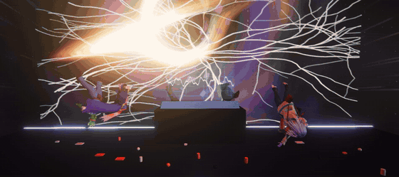
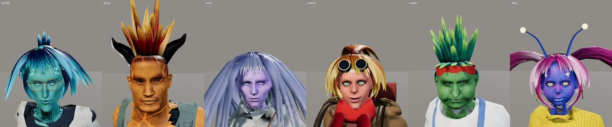
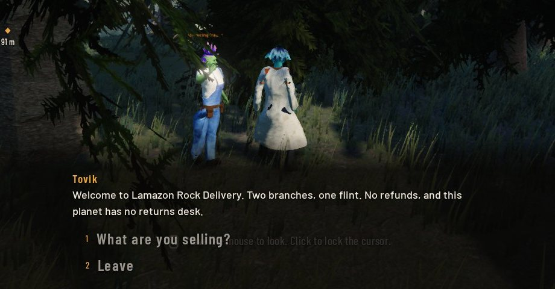
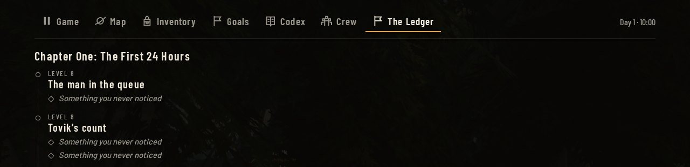
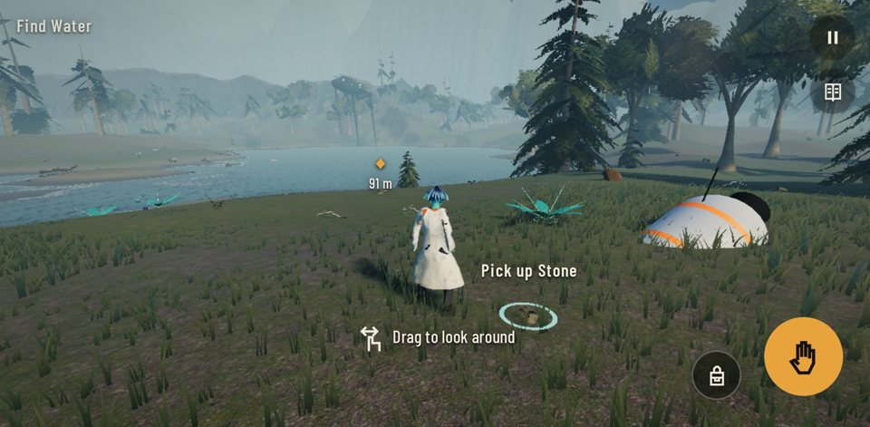

  <a href="https://megazron.github.io/beyond-sagittarius/">
    <picture>
      <source media="(prefers-color-scheme: dark)" srcset="public/brand/logo.svg">
      <source media="(prefers-color-scheme: light)" srcset="public/brand/logo-ink.svg">
      
    </picture>
  </a>

  Humanity conquered the stars. Now you must learn how to survive without civilisation.

  
  &nbsp;
  

  

Year 2189. A suspiciously cheap tourist route to the galactic centre ends at Sagittarius A*.
You wake up alone on a planet nobody charted, with a dying wrist device and something very
large walking between the trees. The jokes come first. The fear catches up.

Then you rebuild science from nothing, one rock at a time, because the way home is a ship and
the ship is several thousand years of homework away.

  

## The game

**Six friends, six faces.** Each one has their own lineage, voice and bad habits. Build your
own Scientist in the character creator.

**Choices that stick.** Timed decisions, quick-time moments and things you never knew counted.
The Ledger keeps all of it, and MegaZroN reads it back to you, rudely.

**Real science, in the right order.** Knap flint, twist cord, fire clay, burn lime, melt sand.
One discovery per level, with a short true explanation in the codex.

**English, Hindi and Urdu.** Text and voices in all three, Urdu right to left. Voice and subtitle
languages are set separately. The voices are synthetic.

**Plays anywhere.** A browser tab, a phone with touch controls, or a Windows build. Keyboard,
mouse and gamepad, with remapping.

| | |
| --- | --- |
|  |  |
|  |  |

## Play

**In a browser:** [megazron.github.io/beyond-sagittarius](https://megazron.github.io/beyond-sagittarius/).
No install, no account. A current browser with WebGL2.

**On Windows:** grab the build from [Releases](https://github.com/megazron/beyond-sagittarius/releases/latest).
Windows 10 or 11, x64. It is unsigned, so SmartScreen will warn you: choose **More info**, then
**Run anyway**.

**On a phone:** open the same link. Phones have only been tested in emulation so far.

Integrated graphics run the Web preset. A laptop GPU or better is suggested for Ultra.

## Controls

| Action | Keyboard and mouse | Touch |
| --- | --- | --- |
| Move | W A S D or arrows | Thumbstick on the left |
| Look | Mouse (click to lock the cursor) | Drag |
| Sprint | Shift | Button |
| Jump | Space | Button |
| Interact | E or F | Button |
| Inventory | I or Tab | Menu |
| Objectives | J or O | Menu |
| Codex | K | Menu |
| Crew | C | Menu |
| Pause | Esc | Button |
| Skip a cutscene | Enter or Esc | Tap |

A gamepad works too, and everything can be remapped in Settings.

## Status

| Part | State |
| --- | --- |
| Opening and title sequence | Playable |
| Chapter One: The First 24 Hours (levels 1 to 10) | Playable |
| Chapter Two: Rocks to Reason (levels 11 to 21) | Playable, voices still being rendered |
| Bronze Age onward, nine ages in all | Planned, locked in the codex |

You play as the Scientist today. Still in progress: more of the story, film-quality cutscenes,
better voices, combat, and the later ages. Hindi and Urdu have not had a native speaker's review.

## Safety

**Do not try this at home.** The science here is simplified for a game and is not instructions.
Fire, heat, chemicals, electricity, sharp tools and pressure can seriously hurt you.

The cutscenes use bright flashes and fast cuts, and the game includes flickering light. If you
are sensitive to that, take care.

## Legal

[Terms](TERMS.md) · [Privacy](PRIVACY.md) · [Licence](LICENSE) · [Credits](CREDITS.md)

All rights reserved. Any brands in the game are parodies. Developer notes are in [DEVELOPMENT.md](DEVELOPMENT.md).
