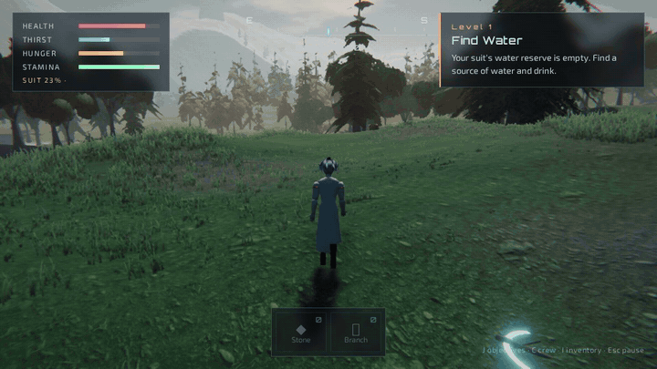
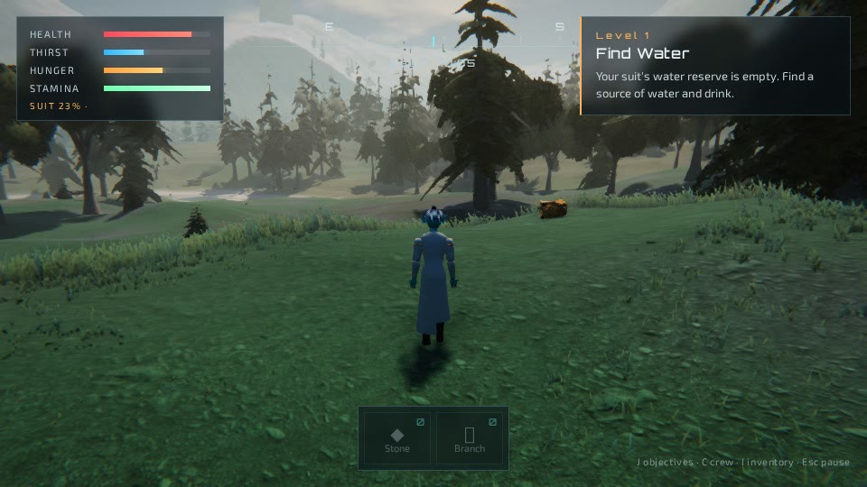
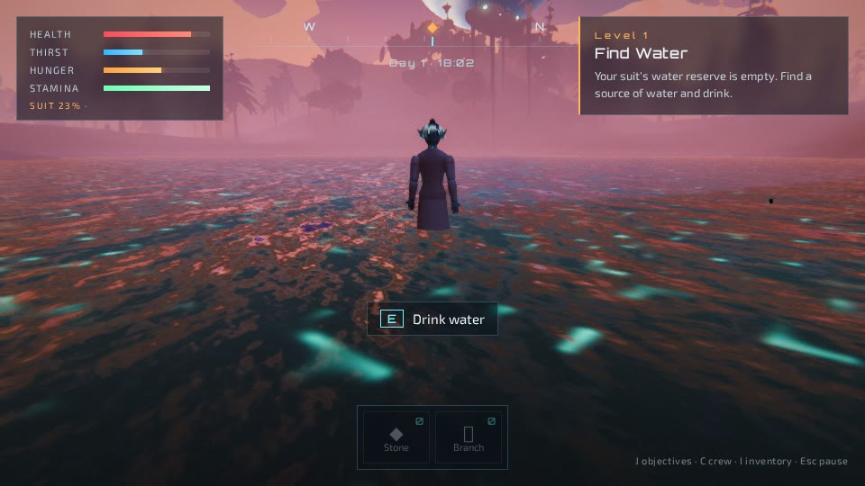
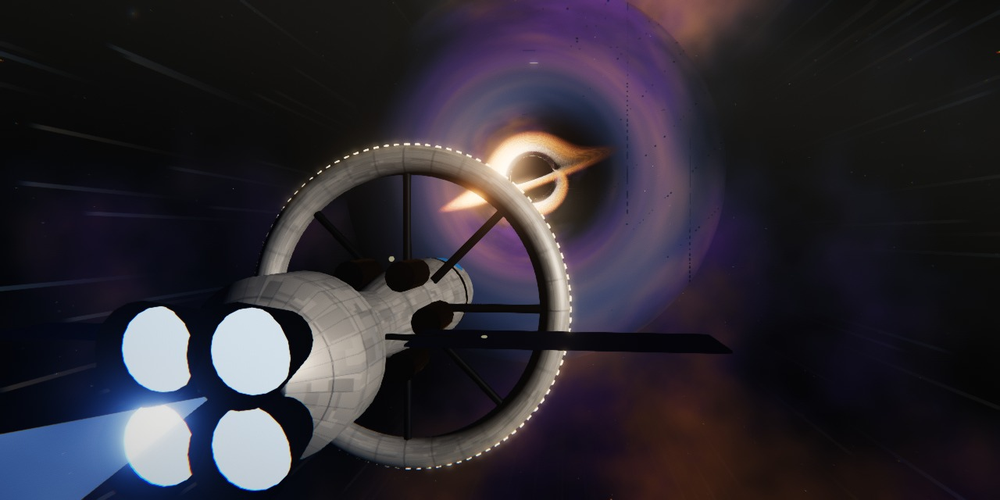
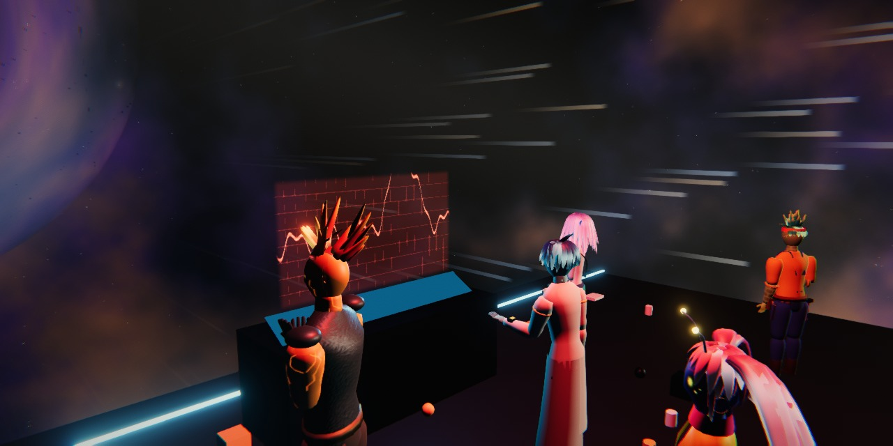

  <a href="https://megazron.github.io/beyond-sagittarius/">
    <picture>
      <source media="(prefers-color-scheme: dark)" srcset="public/brand/logo.svg">
      <source media="(prefers-color-scheme: light)" srcset="public/brand/logo-ink.svg">
      
    </picture>
  </a>

  Humanity conquered the stars. Now you must learn how to survive without civilisation.

  
  &nbsp;
  

  

Year 2189. A suspiciously free tourist route to the galactic centre ends at
Sagittarius A*. You wake up alone on a planet nobody has charted, with a dying
wrist device and something very large walking between the trees. The jokes
come first. The fear catches up.

## What makes it different

**It opens in a browser tab.** No install and no account. It also runs on
phones with touch controls, and there is a Windows build for a bigger screen.

**The narrator keeps score.** MegaZroN hosts the game from the Vault of the Last
Ledger. He reads your choices back to you, including the fruit you should not
have eaten, and he is rude about them.

**English, Hindi and Urdu are all first class.** Text and voices exist in each,
Urdu reads right to left, and voice and subtitle languages can be set separately.
The voices are synthetic.

**Your crew is yours.** Build your Scientist in the character creator and rename
all six friends. Their names follow you through every line and objective.

## Available now

An opening cinematic and Chapter One, *The First 24 Hours*: ten levels of finding
water and food, making fire, building a shelter, surviving a night with a
predator, and following a signal to the first friend you can reach. A few locals
on the planet would also like to sell you a rock.

## Screenshots

| | |
| --- | --- |
|  |  |
|  |  |

## Controls

| Input | Action |
| --- | --- |
| W A S D, arrow keys | Move |
| Mouse | Look (click the world to lock the cursor) |
| Shift | Sprint |
| Space | Jump |
| E or F | Interact |
| I or Tab | Inventory |
| J or O | Objectives |
| C | Crew |
| Esc | Pause |
| Enter or Esc | Skip a cutscene |
| Touch | Joystick on the left, drag to look, pinch to zoom, buttons for the rest |

## System requirements

| | |
| --- | --- |
| Browser | A current desktop browser with WebGL2 |
| Windows | Windows 10 or 11, x64 |
| Phones | A current phone browser (only tested in emulation so far) |
| Graphics | Integrated graphics run the Web preset. A laptop GPU or better is suggested for Ultra. |

The Windows build is unsigned, so SmartScreen will warn you. Choose **More info**,
then **Run anyway**.

Measured on the live site at commit 6366f85 with `tools/gpu_test.py`, Chrome
headless at 1600x900 on an Intel Core Ultra 7 155H laptop. Frames per second:

| GPU | Preset | Title | Narrator | Cinematic | Play |
| --- | --- | --- | --- | --- | --- |
| Intel integrated | Web | 52 | 48 | 56 | 34 |
| NVIDIA RTX A500 Laptop | Web | 60 | 60 | 60 | 47 |
| NVIDIA RTX A500 Laptop | Ultra | 60 | 60 | 59 | 23 |

This was a short standing scene, and the graphics have changed since. Real play
with a mouse and keyboard and real audio have not been tested by a person.

## Roadmap

- Chapter Two, in progress: crafting your way out of the Stone Age
- Finding the rest of the crew, each with their own skills
- Nine ages of civilisation, from stone to the ship home
- Ruins and signals that do not add up
- Co-op for the six crew roles
- More languages

## Legal

[Terms](TERMS.md) · [Privacy](PRIVACY.md) · [Licence](LICENSE) · [Credits](CREDITS.md)

The science in the game is simplified for a game and isn't instructions.

Developer setup is in [DEVELOPMENT.md](DEVELOPMENT.md).
