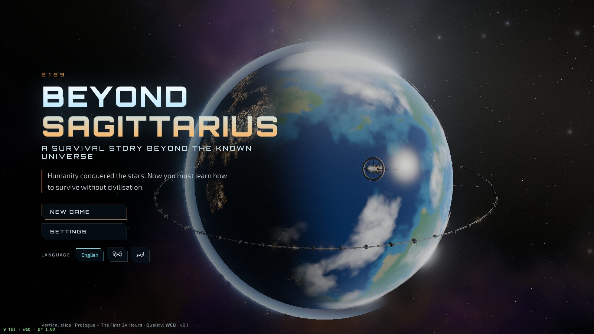
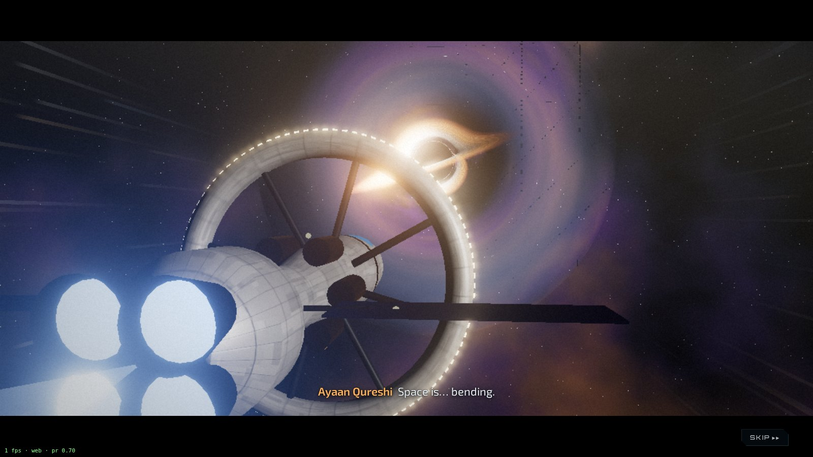
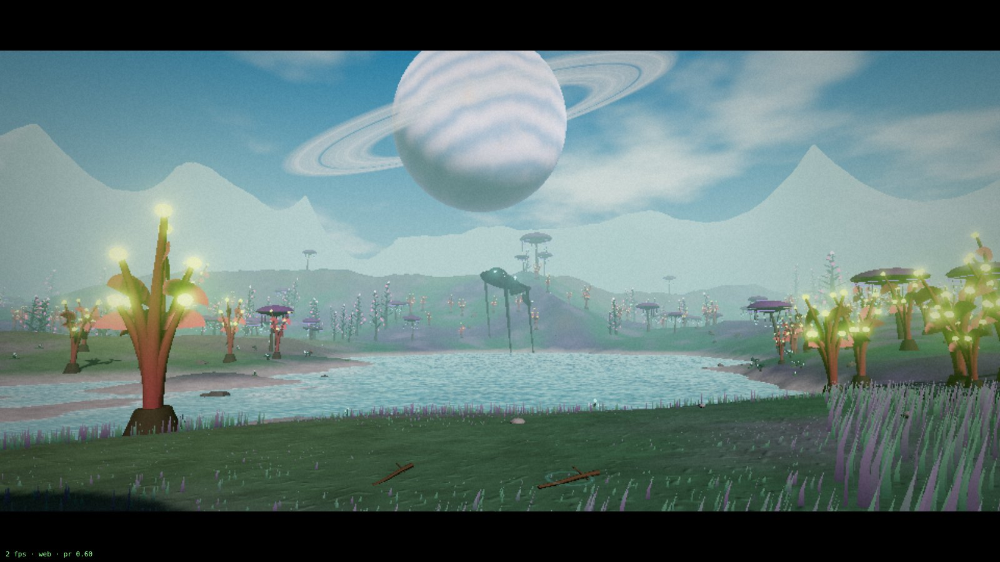
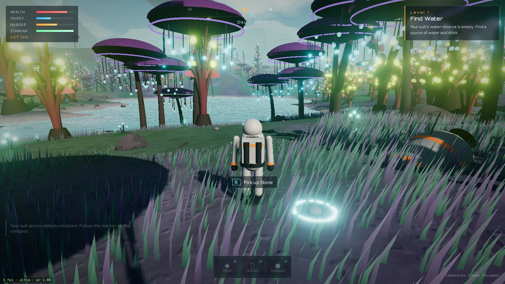
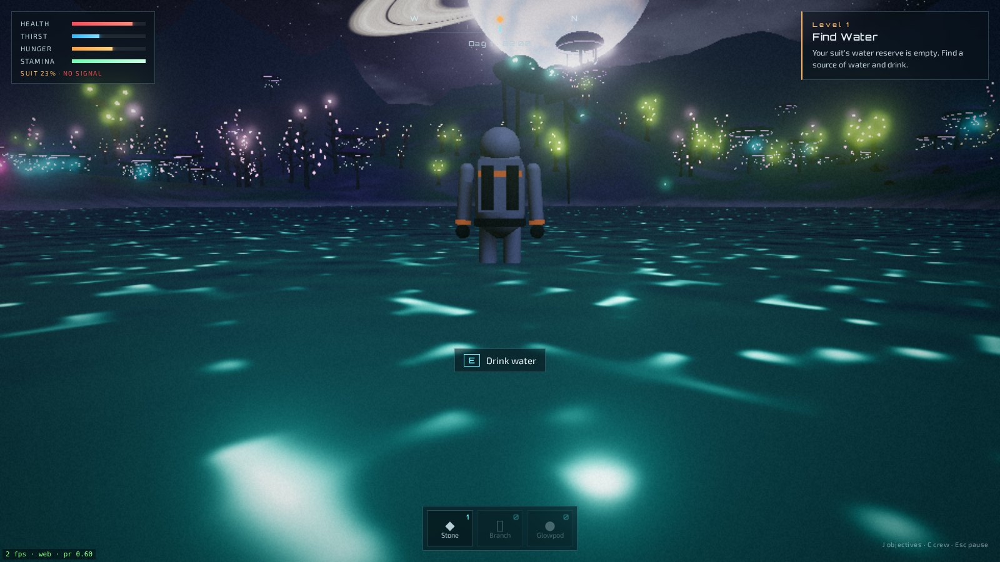

# BEYOND SAGITTARIUS
### A Survival Story Beyond the Known Universe

> *Humanity conquered the stars. Now you must learn how to survive without civilisation.*

An original 3D story-survival game that runs in the browser. This repository
holds the **first playable vertical slice**: the opening cinematic
*"The Last Normal Day"*, the wake-up on an alien world, and the first three
levels of *"The First 24 Hours"*.







## The story so far

Year 2189. Humanity lives across the Solar System — the cities of Mars, the
laboratories of Europa, the stations of Titan, the foundries of the Moon. Six
friends book an interstellar tourist expedition to an observation corridor near
the galactic centre. Near Sagittarius A* an impossible gravitational
disturbance tears the ship apart. You — the Scientist — wake up alone beneath
two huge bodies in an unfamiliar sky, in a damaged suit, in a strange forest
where something enormous walks between the trees.

### The crew (default names, customisable in a later build)

| | Role | Strength |
| --- | --- | --- |
| **Ayaan Qureshi** (you) | The Scientist | Physics, engineering, AI, medical theory. Faster research and crafting, physically weak. |
| Viktor Kade | The Strong One | Carrying, cutting trees, defences, fighting. |
| Leila Haddad | The Medic | Treating injuries, identifying plants, medicines. |
| Mira Santos | The Explorer | Tracking, navigation, finding water and food, scouting. |
| Kenji Arai | The Builder | Tools, shelters, machines, vehicles. |
| Priya Nair | The Social One | Leadership, negotiation, morale, organising. |

## What is in this slice

- **Opening cinematic** (≈60 s, skippable): Earth in 2189 with an atmosphere
  shader, city lights, clouds and an orbital ring with stations; the tourist
  liner's departure with the mission display; a journey montage past a red
  planet and a ringed gas giant through nebulae; the observation deck where the
  Scientist spots the impossible reading; the AI warnings; a ray-marched
  **Sagittarius A\*** black hole with gravitational lensing and an accretion
  disk; gravity failure, escape pods, stretched starlight, a glimpse of another
  universe, white-out.
- **Wake-up sequence**: the moon and the giant ringed planet in the sky, the
  dying wrist device ("CREW STATUS: UNKNOWN / EMERGENCY SIGNAL: NO CONNECTION"),
  the crashed escape pod, and the huge Walker moving between the trees.
- **The alien planet**: procedural 1.4 km × 1.4 km terrain (chunked, 3 LOD
  levels with skirts), three original instanced tree species with
  bioluminescence and wind, GPU grass that follows the player, glowing ground
  plants and rocks, an animated lake (Fresnel sky reflection, sun glint, depth
  colour, shoreline foam, night plankton), sky with clouds, stars and the
  galactic core at night, day–night cycle (1 in-game hour = 50 s), fog.
- **Survival**: health, thirst, hunger, stamina; drinking, examining and eating
  fruit (one species is safe, one is poisonous), picking up stones and
  branches; death and retry.
- **Levels 1–3 fully playable**: Find Water → Find Food (with the Medic's
  advice) → Collect Stones and Branches. Levels 4–10 are listed in the
  objectives log as coming in a future build.
- **Languages**: English, हिन्दी (Hindi) and اردو (Urdu, right-to-left, Noto
  Nastaliq Urdu). Switch on the title screen or in Settings.
- **Saves** to `localStorage` automatically (every 15 s, on level completion
  and when you quit).

## Controls

| Input | Action |
| --- | --- |
| W A S D / arrow keys | Move |
| Shift | Sprint (uses stamina) |
| Space | Jump |
| E (or F) | Interact: drink, examine, eat, pick up |
| Mouse | Look (click the world to lock the cursor; dragging also works) |
| Mouse wheel | Camera distance |
| J (or O) | Objectives log |
| C | Crew |
| Esc | Pause menu (settings, controls, quit) |
| Enter / Esc | Skip cinematic or wake-up sequence |
| Touch | Left side of the screen moves, right side looks, tap the prompt to interact |

## Quality presets

| | **Web** | **Ultra** |
| --- | --- | --- |
| Default when | Hosted (e.g. GitHub Pages) | `npm run dev`, `npm run preview`, any `localhost` |
| Pixel ratio | up to 1.25, **dynamic resolution** (0.6–1.25) to hold ~60 fps | up to 2.0 |
| Shadow map | 1024² | 4096² |
| Trees / plants / rocks | 2 600 / 2 500 / 900 | 7 000 / 8 000 / 2 400 |
| Grass blades | 36 000 (34 m radius) | 150 000 (58 m radius) |
| Terrain LOD0 | 32 segments per 100 m chunk | 64 segments |
| Ambient occlusion | off | GTAO |
| View distance | 420 m | 700 m |

Override with `?quality=web` or `?quality=ultra` in the URL, or pick a preset
in **Settings** (the game saves your progress and reloads). Post-processing
on both presets: HDR render → bloom → ACES filmic tone mapping → vignette,
grain and (in the cinematic) chromatic aberration.

Renderer: WebGL2. A WebGPU path is not included yet — three.js' WebGPU
renderer needs the node-material system, and every custom shader here would
have to be ported to TSL; that is planned rather than half-done.

## Run locally

```bash
npm install
npm run dev        # http://localhost:5173 — Ultra preset by default
npm run build      # production build into dist/
npm run preview    # serve dist/ at http://localhost:4173
```

Smoke test (headless Chromium via Playwright, writes `docs/screenshots/`):

```bash
npm run build
python3 tools/smoke.py --quality web
```

## Deploy to GitHub Pages

`vite.config.ts` uses `base: './'`, so the build works from any sub-path.
`.github/workflows/pages.yml` builds and deploys on every push to `main`.
After creating the GitHub repository: *Settings → Pages → Source: GitHub
Actions*, then push.

## Project layout

```
src/
  main.ts               state machine: title → cinematic → wake-up → play
  core/                 renderer + post-processing, quality presets, noise,
                        save/settings, synthesised audio, astronaut model
  cinematic/            space dome (stars, nebula, black hole), Earth, ship,
                        observation deck, timeline
  world/                terrain, sky, forest, grass, water, props, the Walker
  game/                 input, player controller, survival + objectives
  ui/                   HUD, menus, subtitles, modals
  i18n/                 en.json, hi.json, ur.json
```

## Roadmap (full design)

1. **The First 24 Hours** — levels 4–10: primitive tools, shelter before
   nightfall, fire, surviving the first night, the unfamiliar plant, evidence
   that something else lives here, a perfectly undamaged ship fragment.
2. **Finding the friends** — each rescued crew member unlocks their skill
   tree and changes how the group survives.
3. **Nine ages of civilisation**, drawing on human history: Stone → Fire &
   Tools → Agriculture → Bronze → Iron → Classical → Industrial → Space →
   Civilisation.
4. **The mystery system** — ruins, signals and artefacts that don't add up.
5. **Level 99** — *"SUBJECTS: SIX. ORIGIN: EARTH. … YOU WERE NOT THE FIRST TO
   ARRIVE … HUMANITY HAS BEEN HERE BEFORE … WELCOME BACK."*
6. **Co-op multiplayer** for the six crew roles.
7. More languages; customisable names and genders; WebGPU renderer.

## Credits

See [CREDITS.md](CREDITS.md). All assets are procedurally generated.
